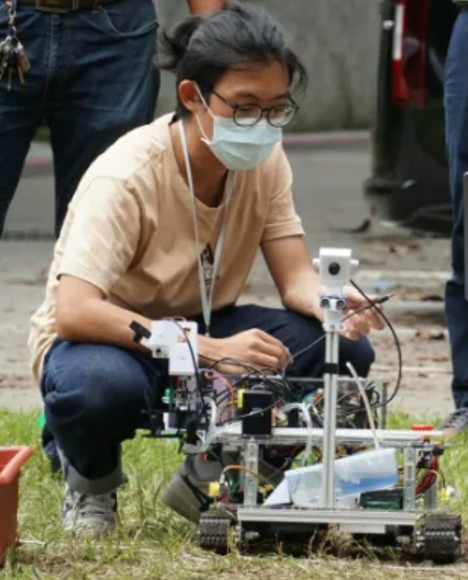

### Hi, I'm Kai-Chun Chang

I'm a **mechanical / product design engineer in training**: I design mechanisms and enclosures in SolidWorks, check them with FEA and CFD, build the prototypes, and integrate the electronics so the whole product works.

- M.S. in Biomedical Engineering at **National Taiwan University** (expected January 2028). B.S. in Biomechatronics Engineering at NTU, plus an exchange semester at TU Berlin (RISE exoskeleton team).
- I take products from **SolidWorks CAD and engineering drawings** through **sheet metal, aluminum extrusions, 3D printing, laser cutting, and wood** to a working prototype, then fit the electronics (Raspberry Pi, Arduino).
- Simulation-driven design: a CFD-driven fan and inlet redesign in SolidWorks Flow Simulation (effective suction width 25 mm → 125 mm, verified by pickup tests), and coronary stent expansion with nonlinear contact in ANSYS Workbench (course project).
- Thesis: magneto-acoustic imaging simulation. I'm proposing an ultrasound imaging method that uses tissue electrical conductivity as the contrast source and building a coupled FEM chain in openCFS (coil field → Lorentz damping → piezo pulse-echo).
- Looking for 2027 product design / mechanical engineering internships and roles in Taiwan.

---

### Projects

<table>
<tr>
<td width="50%" align="center">
 
<b><a href="https://github.com/kaichunchang-portfolio/smart-mirror-google-hps">SuPi Mirror</a></b> 
Google Hardware Product Sprint 2023, team leader and PM. Designed a 584 × 368 × 115 mm wood and one-way-mirror enclosure in SolidWorks, checked fit against the monitor, Pi, and speaker models, released the frame and bezel drawings, assembled the woodworker-cut panels with the electronics, and created exploded views for the final demo.
</td>
<td width="50%" align="center">
 
<b><a href="https://github.com/kaichunchang-portfolio/vacuum-cleaning-robot-cad">Vacuum-Cleaning Robot</a></b> 
Project leader. Designed the SolidWorks assembly around the airflow path, laying out the drivetrain, sensors, and electronics on a Ø210 mm round base; resized the fan and iterated the inlet plate with CFD and pickup tests, widening the effective suction width from 25 to 125 mm (5×).
</td>
</tr>
<tr>
<td width="50%" align="center">
 
<b>Autonomous Field Robot</b> 
Team leader, Honorable Mention at the NTU Field Robot Competition. Designed all mechanisms in SolidWorks (tracked chassis, slide-rail gripper, electronics enclosure, and a quick-release battery mount that cut swap time from 120 s to 5 s, a 96% reduction), and built the frame from aluminum extrusions and sheet metal, with laser-cut plates and 3D-printed gripper parts.
</td>
<td width="50%" align="center">
 
<b><a href="https://github.com/kaichunchang-portfolio/laser-cut-night-light-workshop">Laser-Cut Night Light Workshop</a></b> 
Lead organizer. Designed a three-layer acrylic night-light kit in SolidWorks and taught laser cutting to junior-high and high-school students, who built the lights with their own drawings engraved on the acrylic.
</td>
</tr>
</table>

Also on GitHub:

- **[Wearable PPG Sensor Board](https://github.com/kaichunchang-portfolio/wearable-ppg-sensor-board)**: a 52 mm round, 0.4 mm thick 2-layer carrier PCB that connects a MAX30102 sensor to a Raspberry Pi Pico over I2C, with a STEP model for enclosure fit checks and a full fabrication package (course group project; I drew the PCB; not fabricated).

Also built (files not public):

- **Calf feeding monitor** (Biophotonics and Bioimaging Lab, NTU): I built automated image data acquisition on a Linux Raspberry Pi; a Python/OpenCV script captured a farm image every 10 s and streamed it to the lab server over imageZMQ to build the training set; I then trained a YOLOv8 transfer-learning model on these images to detect calf heads for feeding monitoring.

---

### Outside the lab

I played on my department volleyball team at NTU for four years and was vice captain in my sophomore year. I led practices, kept the team together, and gave the pep talks during matches. I enjoy working as part of a team, and volleyball taught me never to give up.

---

### Toolbox

**CAD & simulation tools:** SolidWorks · engineering drawings · ANSYS Workbench · SolidWorks Flow Simulation · COMSOL · openCFS 
**Analysis:** FEA · CFD · static load analysis · GD&T and tolerance analysis (auditing Machine Design Theory, 2026) 
**Prototyping:** sheet metal · aluminum extrusion framing · 3D printing · laser cutting · electromechanical assembly 
**Electronics & code:** Arduino · Raspberry Pi · Python (OpenCV, automated data acquisition) · C/C++ · MATLAB 
**Languages:** Mandarin (native) · English (IELTS 7.0) · German (beginner)

---

[LinkedIn](https://www.linkedin.com/in/kai-chun-kevin-chang-191527282) · kaichunchangwork@gmail.com
